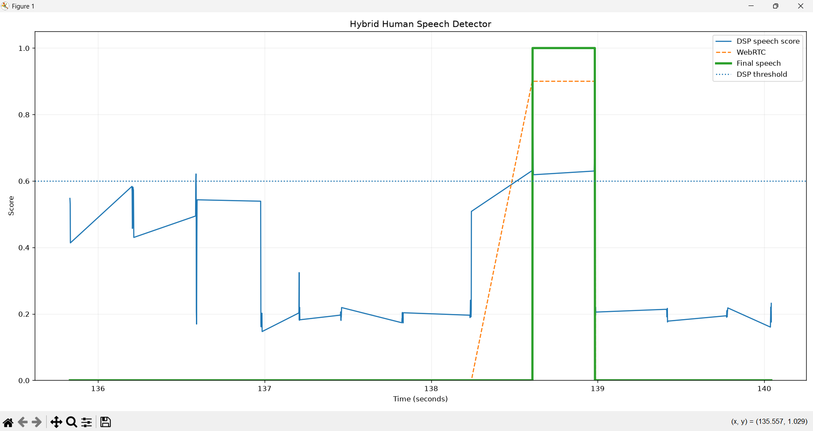
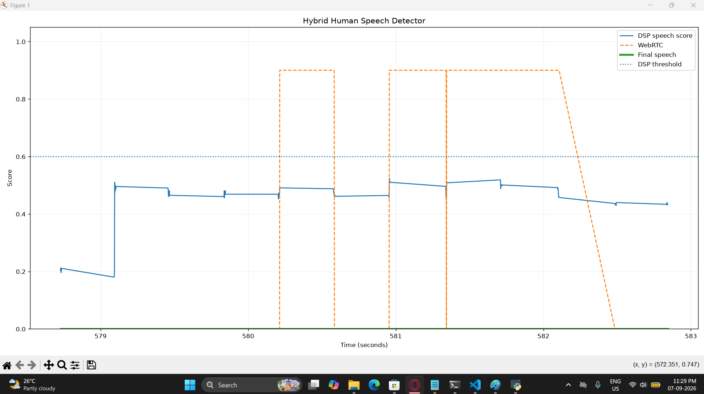

# ESP32-S3 Edge Audio & Voice-Activated Drone Interface

An experimental embedded voice activation system built using the **ESP32-S3**, combining real-time audio processing, lightweight speech detection, and custom INT8 keyword spotting (KWS) to trigger an external drone interface.

The project explores low-overhead, always-on audio processing directly on a microcontroller without requiring cloud connectivity for wake-word detection.

## Demonstration

**[Watch Demonstration Video on YouTube](https://youtu.be/0ie85YYeCwQ)** *(or watch the local repository file: [./Demonstration.mp4](./Demonstration.mp4))*

## Features

- Continuous 16 kHz, 16-bit mono audio acquisition through I2S.
- 1.5-second circular audio pre-roll buffer.
- WebRTC Voice Activity Detection (VAD).
- FFT, Mel Spectrogram, and Zero-Crossing Rate (ZCR) analysis.
- Hybrid speech and environmental noise filtering.
- Custom INT8 quantized keyword spotting model.
- Local wake-word detection using ESP32-S3.
- Event-driven relay activation for drone interface initialization.
- FreeRTOS-based task management and memory optimization.

## System Architecture

```text
       I2S Microphone
             |
             v
      Audio Acquisition
             |
             v
       Ring Buffer
             |
             v
      Audio Processing
             |
             v
         WebRTC VAD
             |
             v
      Hybrid Noise Filter
             |
             v
      Feature Extraction
             |
             v
       INT8 KWS Model
             |
             v
       Wake Verification
             |
             v
      Relay Activation
             |
             v
      Drone Interface
```

## Experimental Results

| Parameter | Reported Result |
|---|---:|
| Hardware | ESP32-S3 Dual-Core |
| CPU Utilization | 7.92% |
| KWS Model Size | ~68.4 KB |
| Runtime Memory Usage | 186.5 KB |
| Audio Buffer | 46.88 KiB |
| Audio Pre-roll | 1.5 seconds |
| Acquisition Stack Headroom | >1,800 words |
| DSP/Inference Stack Headroom | >1,200 words |

*Values are preliminary measurements from the experimental implementation. CPU utilization, memory accounting, and model footprint require standardized benchmarking for independent verification.*

## Detection Pipeline

The hybrid detection stage combines VAD with signal-processing features to distinguish speech-like activity from environmental noise.

**Speech Detection**



**Environmental Noise Rejection**



## Optimization

- **DSP:** Fixed-point arithmetic and ESP-DSP optimized signal-processing routines.
- **Inference:** INT8 quantization and ESP-NN optimized kernels.
- **Memory:** Circular buffering and reusable processing buffers.
- **Compiler:** `-Os` optimization and Link-Time Optimization (LTO).
- **RTOS:** Lightweight task notifications and stack usage monitoring.
- **Memory placement:** Selective IRAM placement for time-critical routines.

## Current Limitations

- False activation and rejection rates under actual drone rotor noise are not yet characterized.
- End-to-end wake-word detection latency requires further benchmarking.
- Power consumption and energy per inference have not yet been measured.
- Long-duration reliability testing remains ongoing.

## Future Work

- Benchmark false activations per hour (FAH) and false rejection rate (FRR).
- Evaluate detection performance under real rotor noise.
- Profile inference and activation latency.
- Measure actual power consumption.
- Optimize post-activation audio streaming.
- Improve wake-word model robustness.

## Technologies

`ESP32-S3` `ESP-IDF` `FreeRTOS` `C/C++` `ESP-DSP` `ESP-NN` `WebRTC VAD` `TinyML` `TensorFlow Lite Micro` `I2S`

---

**Project Status:** Experimental Prototype / Active Development
